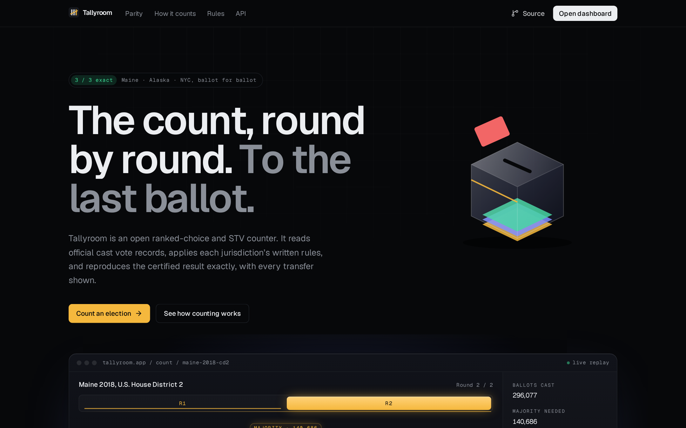
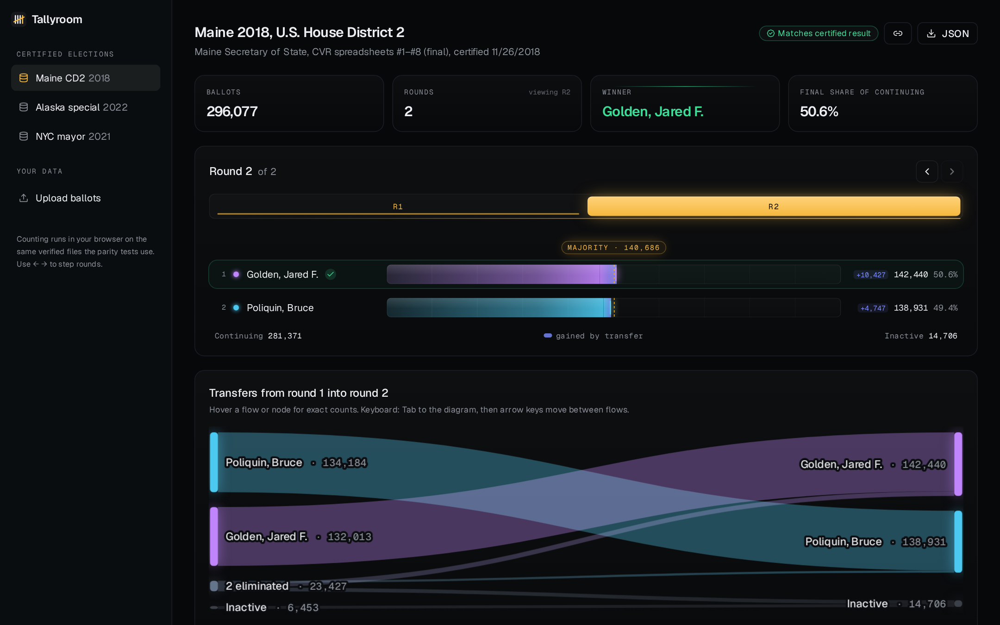
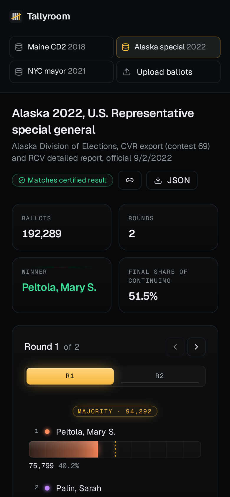
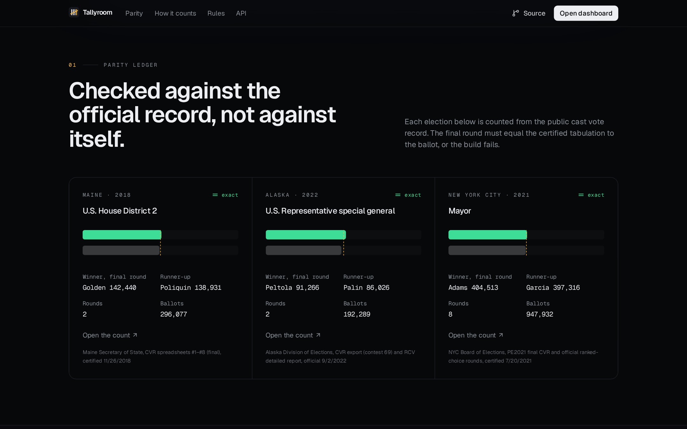
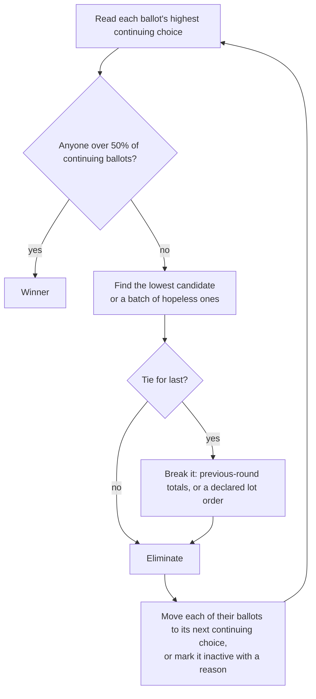
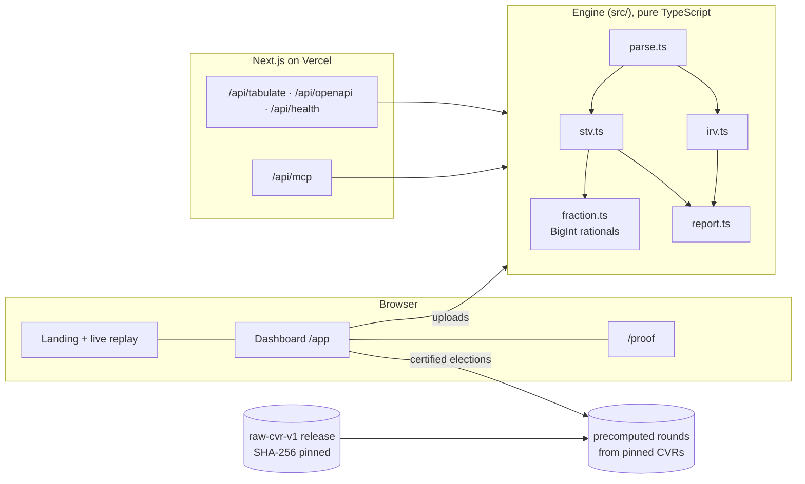
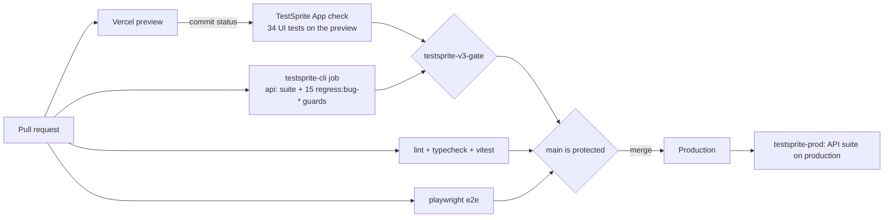
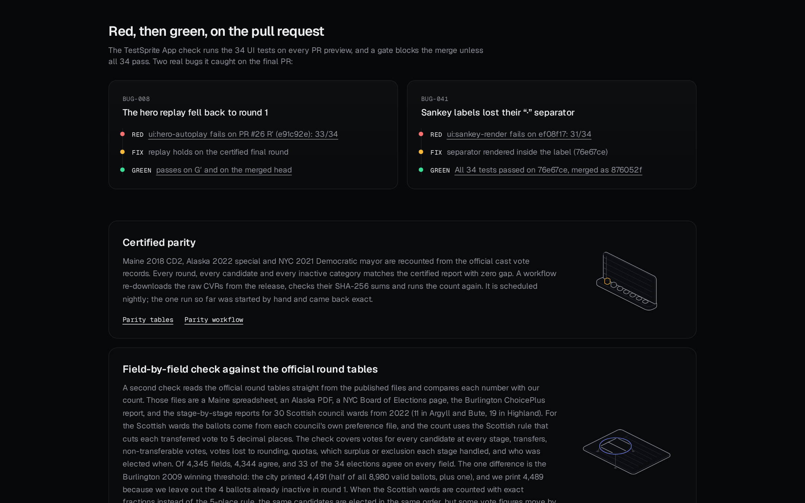
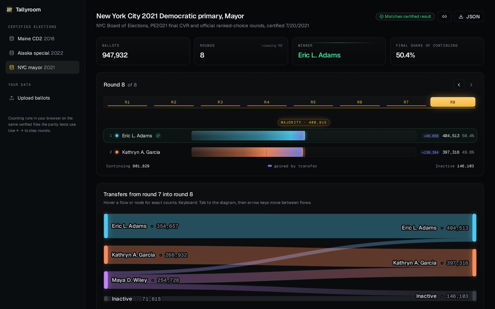

<div align="center">

# Tallyroom

**Exact ranked-choice and STV counting, checked line by line against government-certified results.**

[Live site](https://tallyroom-rosy.vercel.app) · [Dashboard](https://tallyroom-rosy.vercel.app/app) · [Proof page](https://tallyroom-rosy.vercel.app/proof) · [API contract](https://tallyroom-rosy.vercel.app/api/openapi) · [Defect ledger](audit/defects.md)

`4,344 / 4,345 official fields matched` · `34 / 34 TestSprite UI tests on the merged head` · `330 Vitest` · `98 Playwright runs` · `92.54% engine mutation score`



</div>

---

## Contents

1. [What it does](#what-it-does)
2. [How we know the count is right](#how-we-know-the-count-is-right)
3. [How the count works](#how-the-count-works)
4. [Architecture](#architecture)
5. [TestSprite: red, then green, on every PR](#testsprite-red-then-green-on-every-pr)
6. [The defect ledger](#the-defect-ledger)
7. [Every test suite, and what runs it](#every-test-suite-and-what-runs-it)
8. [Use it from code or an AI agent](#use-it-from-code-or-an-ai-agent)
9. [Run it locally](#run-it-locally)
10. [Numbers and where they come from](#numbers-and-where-they-come-from)

---

## What it does

Ranked-choice results are usually published as one final table. Tallyroom recounts the election from the public cast vote records and shows **every round, every transfer and every ballot that became inactive, and why**. It reproduces the certified result exactly, and it tells you which counting rules it used to get there.

| | |
|---|---|
| **Certified elections** | Maine 2018 U.S. House District 2, Alaska 2022 U.S. House special, NYC 2021 Democratic mayoral primary, plus Burlington VT 2009 and 30 Scottish council wards in the field-level check |
| **Your own ballots** | Paste or upload ranking text (`5,A>B`), one-rank-per-column CSV, or JSON; get IRV or multi-seat STV |
| **Exact arithmetic** | Every surplus and transfer value is a BigInt rational. Nothing is rounded unless the jurisdiction's rule says so |
| **Open** | REST with an OpenAPI 3.1 contract, and an MCP server for AI agents |

<table>
<tr>
<td width="62%"></td>
<td width="38%"></td>
</tr>
<tr><td>Maine 2018, round 2: Golden passes the majority line with 10,427 transferred ballots.</td><td>The same dashboard at 390 px.</td></tr>
</table>

## How we know the count is right

Three independent checks, from coarse to fine.

| Check | What it compares | Result | Where |
|---|---|---|---|
| **Certified parity** | Every round, candidate and inactive category against the certified report, recounted from the raw CVRs | 4 of 4 elections exact, 119 compared figures, 0 gaps | [`PARITY.md`](PARITY.md), [`audit/parity/README.md`](audit/parity/README.md) |
| **Field-level parity** | Each number in the official round tables (votes per stage, transfers, non-transferable, rounding loss, quotas, who was elected when) | **4,344 of 4,345 fields** across 34 elections; 33 match on every field | [`audit/parity/field-parity.md`](audit/parity/field-parity.md) |
| **Differential fuzz** | Our engine against `fuzz/oracle.py`, a second counter written separately in Python | Hostile mode finds every past bug on old builds and none on this one | [`audit/fuzz/hostile/seed1-by-build.md`](audit/fuzz/hostile/seed1-by-build.md) |

| Election | Ballots | Source | Result |
|---|---|---|---|
| Maine 2018, U.S. House District 2 | 296,077 | official cast vote records | every round, candidate and inactive category matches |
| Alaska 2022, U.S. House special | 192,289 | official cast vote records | same |
| NYC 2021, Democratic mayor primary | 947,932 | official cast vote records | same |
| Burlington VT 2009, mayor | 8,980 | PrefLib conversion of the city's ballot file | same (certified under the overvote rule "continuing") |
| 30 Scottish council wards, 2022 | per ward | each council's preference file and stage reports | every field, using the Scottish 5-decimal transfer rule |

**The one mismatch, explained.** Burlington printed a winning threshold of 4,491 (half of all 8,980 valid ballots, plus one). We print 4,489, because we leave out the 4 ballots that were already inactive in round 1. Both are defensible definitions; we did not change our rule to hide the difference.

The raw files are pinned by SHA-256 in the [`raw-cvr-v1`](https://github.com/goat-dev8/tallyroom/releases/tag/raw-cvr-v1) release. `parity-nightly.yml` downloads them again, checks the hashes and recounts. It has one run so far, started by hand ([run 39385031100](https://github.com/goat-dev8/tallyroom/actions/runs/39385031100), exact); the scheduled cron has not fired yet. `npm run parity` exits non-zero on any gap.



## How the count works

### Single-winner IRV (`src/irv.ts`)



Every rule that can change a result is a named option, and the presets reproduce each jurisdiction:

| Option | Values | What it decides |
|---|---|---|
| `overvote` | `exhaust`, `skip`, `continuing` | Two candidates at the same rank |
| `skips` | `continue`, `two-exhaust` | Blank ranks; Maine exhausts after two in a row |
| `duplicates` | `ignore`, `skip` | The same candidate ranked twice |
| `batch` | `true` / `false` | Eliminate every mathematically hopeless candidate at once (IRV only) |
| `tiebreak` | `previous-round`, `lot` (+ `lotOrder`) | Ties for last place |

Inactive ballots are split into separate categories (blank, overvote, skipped ranks, undervote, exhausted), the way certified reports print them.

### Multi-seat STV (`src/stv.ts`, `src/fraction.ts`)

- **Quota:** Droop or Hare, computed as an exact fraction.
- **Surplus:** Gregory method. Each ballot of an elected candidate moves on at the transfer value *surplus ÷ candidate total*, kept as a BigInt numerator and denominator.
- **Rounding only on request:** with `transferDecimals: 5` the count truncates each transfer to 5 places, as Scottish rule 48(3) requires. That is how the 30 Scottish wards match their stage reports. Counted exactly instead, the same candidates are elected in the same order, and some vote figures move by up to 0.021.
- **Bounds:** exact numbers are capped (`MAX_EXACT_BITS`) so a hostile file cannot make the server do unbounded work.

### Parsing (`src/parse.ts`)

Ranking text (`5,A>B`, `_` for a skipped rank, `[A=B]` for an overvote), one-rank-per-column CSV, or JSON. The parser rejects ambiguous files with a named error code rather than guessing, and many of the bugs in the ledger were found here.

## Architecture



The same engine counts in the browser, behind the REST API and behind the MCP tools, so the dashboard, the API and the parity checks cannot drift apart. The certified elections are precomputed at build time (`scripts/precompute-rounds.ts`) from the pinned files.

## TestSprite: red, then green, on every PR

TestSprite is wired in three places, and none of them can be skipped.



- **App check.** The TestSprite GitHub App runs all 34 UI plans (`testsprite/frontend/`) against the PR's own Vercel preview.
- **The gate.** TestSprite's status reads "success" even when tests fail (PR #22 merged with `ui:hero-autoplay` failing). So `scripts/testsprite-gate.mjs` reads the status on the PR head, parses "All N tests passed" or "x/N", and fails unless the UI run is N/N **and** `testsprite-cli` is green on the same commit. It fails closed: no result means red.
- **CLI job.** `testsprite-cli.yml` runs the 22 `api:` tests and the 15 `regress:bug-*` guards on the preview for the files the push touched, and fails unless every guard passes.
- **Branch protection.** `main` requires `testsprite-v3-gate`, `testsprite-cli`, `lint + typecheck + vitest` and `playwright e2e`, with admins included.

### The final PR, step by step ([#26](https://github.com/goat-dev8/tallyroom/pull/26))

| Commit (Cairo time) | TestSprite UI | What it showed |
|---|---|---|
| R′ `e91c92e` (01:36): guards added, fixes held back | **33/34**, [e34f1719](https://www.testsprite.com/dashboard-v3/o/dd10cd84-8b8f-5d0b-87b0-254e74a42770/projects/f312fcf5-741d-4116-bed4-c7ac9334859a/execution/e34f1719-cc5a-4eaf-a7ed-5f66b84b58f1) | **BUG-008:** the hero replay fell back to round 1. The CLI guards went 0/15 (every API bug still live) |
| G′ `9d01828` (02:05): fixes | 33/34 | `ui:hero-autoplay` green, guards 15/15; one table test could not read an em dash (test fragility, fixed) |
| `d8847a9` (02:26) | 34/34 | Gate green; lint red on the gate script, fixed in the next commit |
| `ef08f17` (02:32) | **31/34**, [adac70d0](https://www.testsprite.com/dashboard-v3/o/dd10cd84-8b8f-5d0b-87b0-254e74a42770/projects/f312fcf5-741d-4116-bed4-c7ac9334859a/execution/adac70d0-8e0a-48bb-be69-90a18639f145) | **BUG-041:** Sankey labels had no `·` between name and count, a bug live since PR #15 that earlier passes had missed |
| `76e67ce` (02:56) | **34/34**, [f118839c](https://www.testsprite.com/dashboard-v3/o/dd10cd84-8b8f-5d0b-87b0-254e74a42770/projects/f312fcf5-741d-4116-bed4-c7ac9334859a/execution/f118839c-f6b3-4ad0-8d2c-12275d9754e2) | Every required check green; merged as `876052f` at 03:00 |

The full record, with screenshots of the PR checks, the merge box and the TestSprite portal, is in [`audit/testsprite/final-pr/`](audit/testsprite/final-pr/README.md). The earlier 15-bug red/green round on production is in [`audit/testsprite/pr-red-green/`](audit/testsprite/pr-red-green/) and [`audit/testsprite/prod-red/`](audit/testsprite/prod-red/).

**What did not work, said plainly.** The TestSprite App's API runs on PRs #25 and #26 failed every test in about 2 seconds with "TestSprite hit an internal error", with 0 steps. Those were not results, so the API App trigger is disabled and the API side runs through our own `testsprite-cli` job instead.



## The defect ledger

[`audit/defects.md`](audit/defects.md) has **43 rows** (BUG-001 to BUG-041, plus B-001 and B-002 from before the numbering). Each row names what caught the bug, links the failing run, the fix and the passing run.

| Who found it | Rows |
|---|---|
| A TestSprite test, first (BUG-001 to BUG-005, BUG-008, BUG-041, B-001, B-002) | 9 |
| Vitest while writing parser tests, the differential fuzzer, local bug hunts, independent reviews and manual QA | 34 |

We do not count a bug as a TestSprite catch when the TestSprite test was written after someone else found it. Those rows say "regression test, written after the bug was found". Two manual-QA batches are kept in a separate table and count as one finding each. Rows are corrected in place, never deleted, and every correction is in the log at the bottom.

## Every test suite, and what runs it

| Suite | Size | Runs on |
|---|---|---|
| TestSprite UI (`testsprite/frontend/`) | 34 plans, the same 34 tests in the TestSprite project | every PR preview (App check) |
| TestSprite API (`testsprite/backend/`) | 22 tests, plus 15 `regress:bug-*` guards | PR previews (`testsprite-cli.yml`), and production after merges (`testsprite-prod.yml`) |
| Vitest (`test/`) | 330 tests in 47 files (the 600-case fuzz corpus and the 120-case hostile corpus are 1 test each) | every PR and push (`ci.yml`) |
| Playwright (`tests/e2e/`) | 49 tests × 2 viewports (1440 px and 390 px) = 98 runs; 14 are viewport-specific and skip on the other viewport (84 pass, 14 skip, 0 fail locally on 2026-10-21) | every PR (`ci.yml`, `playwright e2e`) |
| Mutation (Stryker) | engine (`irv.ts`, `stv.ts`, `fraction.ts`) 92.54%, `parse.ts` 78.95% | locally ([`audit/mutation/`](audit/mutation/README.md)) |
| Requirements | R1–R23 mapped to tests; `test/prd.test.ts` fails if a named test file is missing | every PR ([`docs/PRD.md`](docs/PRD.md), [`audit/traceability.md`](audit/traceability.md)) |

## Use it from code or an AI agent

```bash
curl -s https://tallyroom-rosy.vercel.app/api/tabulate -H 'content-type: application/json' \
  -d '{"ballots":"5,Ada>Bo\n4,Bo>Ada\n2,Cy>Bo"}'
```

- **REST:** `POST /api/tabulate` (add `seats` for STV, `rules` for any option above). The contract is `GET /api/openapi` (OpenAPI 3.1), and `test/openapi.test.ts` checks it against the handlers. Errors come back as `{ error: { code, message } }` with a stable code.
- **MCP:** `/api/mcp` (streamable HTTP), or `npx tsx mcp/stdio.ts` locally. Tools: `count_ballots`, `list_elections`, `election_rounds`, `counting_rules` ([`audit/api-mcp/`](audit/api-mcp/)). Neither has a TestSprite test yet.



## Run it locally

```bash
npm ci
npm test                 # Vitest: engine, parity, properties, API
npm run parity           # computed vs certified tables; non-zero exit on any gap
npm run build && npx next start -p 3100
npm run e2e              # Playwright against http://localhost:3100
```

Deploys: `scripts/vercel-ignore.sh` skips builds for docs-only and CI-only changes. [`audit/vercel-deployments.md`](audit/vercel-deployments.md) is the deploy record, exported from the Vercel API.

## Numbers and where they come from

Every number on this page and on `/proof` was checked on 2026-10-21 against its source:

| Number | Source |
|---|---|
| 4,344 / 4,345 fields, 33 / 34 elections | last line of `audit/parity/field-parity.md` |
| 119 figures, 0 gaps | `audit/parity/README.md` |
| 34 / 34 UI on `76e67ce` | the `TestSprite V3` commit status on that commit |
| 43 ledger rows, 9 TestSprite-first | the rows of `audit/defects.md` and their "Found by" column |
| 330 Vitest, 47 files | `npx vitest run` |
| 98 Playwright | `npx playwright test --list` |
| 92.54% / 78.95% | `audit/mutation/README.md` |
| Required checks | the GitHub branch-protection API for `main` |

---

<sub>Built for TestSprite Hackathon Season 4. Line figures on the site by [Hairline](https://github.com/lucasmarkes/hairline) (MIT); background threads by React Bits. See [`THIRD_PARTY_NOTICES.md`](THIRD_PARTY_NOTICES.md).</sub>
